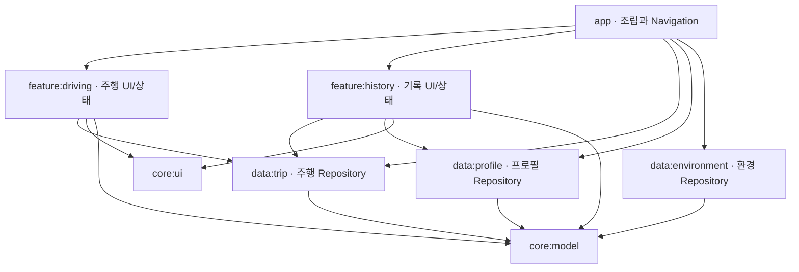

# 아키텍처와 결정 이유

## 기준

공식 Android 권장 구조의 **UI 계층·데이터 계층·Repository·화면별 ViewModel·단방향 상태 흐름**을 적용합니다. 모듈 수 자체가 목표가 아니며 현재 협업 경계를 컴파일러로 구분할 만큼만 분리했습니다.

앱은 공통 모델·UI도 직접 사용할 수 있습니다. 두 feature 사이의 의존성은 없습니다.

## 각 모듈의 이유

| 모듈 | 공개 영역 | 숨기는 것 |
| --- | --- | --- |
| app | 앱 진입점·메인 화면 조립·객체 조립 | 기능의 데이터 처리 로직과 기능별 화면 경로를 두지 않음 |
| core:model | ID·기록·샘플·오류 결과 등 순수 Kotlin 타입 | Android·DB·UI 의존 없음 |
| core:ui | 재사용 Section·기능 자리 UI | Repository·업무 로직 없음 |
| data:trip | TripRepository, VehicleRecorder, 샘플·차량 생성 함수 | DB·SQL·세션·입력·샘플을 internal로 제한 |
| data:profile | ProfileRepository, Repository 생성 함수 | DB·SQL을 internal로 제한 |
| data:environment | EnvironmentRepository, 차량용·미지원 생성 함수 | 공조·위치 SDK, 대기질 HTTP, DB·캐시를 internal로 제한 |
| feature:driving | DrivingViewModel·주행 컴포넌트 | 주행 UI 상태를 독립 관리 |
| feature:history | historyGraph·목록/상세/프로필 ViewModel·기록 관련 화면 | 상세 로딩·오류·재시도 상태를 독립 관리 |

프로필·평가·출발/종료 화면은 기록 흐름과 함께 움직이므로 history 안에 둡니다. 저장은 feature가 할 수 없으므로 data:profile에 둡니다. 실제 기능이 커지거나 독립 변경이 잦아지면 기능 단위로 분리합니다. 빈 기능마다 Gradle 모듈을 만들지 않았습니다.

## 상태 흐름

사용자 입력 → 해당 화면 ViewModel → Repository → 원본 저장/상태 → StateFlow → Compose.

- DrivingViewModel: 초기화·기록 중 상태·명령 처리·완료 ID.
- HistoryViewModel: 기록 목록 관찰, 구독 수명에 맞춰 StateFlow 유지.
- TripDetailViewModel: 선택 ID의 로딩/본문/없음/오류, 재시도. 이전 조회가 늦게 끝나도 새 선택을 덮어쓰지 않음.
- ProfileViewModel: 사람 목록 관찰, 로딩·오류·재시도.
- app: 메인 화면과 객체 조립. 상세의 busy 상태를 주행 명령과 공유하지 않음.

Navigation Compose의 back stack을 사용합니다. 평가 자리에서 뒤로 가면 이전 상세로 복귀하며, 각 상세 ViewModel은 해당 destination에 묶입니다. DrivingViewModel은 앱의 기록 UI 흐름 수명을 갖습니다.

`app`의 `MainHost`는 home 경로와 `historyGraph` 호출만 갖습니다. 기록 쪽 경로, ViewModel 생성, 상태별 화면은 feature:history 안에 있어 화면을 추가해도 `MainHost`를 고치지 않습니다. 주행 쪽에 별도 화면이 생기면 같은 방식으로 feature:driving에 그래프를 추가합니다.

## 저장·주입

구조를 바꿀 때 DB 이름을 유지해 데이터를 초기화하지 않았습니다. 주행 DB는 패턴·조향·안내 결과 저장을 위해 v4로 올렸고, 마이그레이션은 테이블만 추가합니다. SqliteTripStore와 DB helper는 data 모듈 internal이라 feature에서 접근하면 컴파일되지 않습니다.

패턴 탐지는 `data:trip` 내부의 `PatternDetector`가 맡습니다. 샘플을 한 건씩 받아 판정하므로, 주행 중 안내가 저장이 끝나기를 기다리지 않습니다. 탐지 결과는 공개 모델 `Observation`으로 저장하며, 화면은 `TripSnapshot`으로만 읽습니다.

좌우 움직임은 `LateralDetector`가 맡고, 반복 판정은 앞뒤와 같은 `SwingTracker`를 씁니다. 조향은 Vehicle SDK로만 읽을 수 있어(`CarPropertyManager`의 조향 권한은 `signature|privileged`) `data:trip`이 이 SDK에 의존합니다. 저장소는 `settings.gradle.kts`에서 해당 그룹으로만 제한했습니다. 조향이 끊겨도 속도 기록은 계속되고, 마지막 값으로 판정을 이어가지 않습니다.

주행 중 안내는 판단과 표시를 나눕니다. `data:trip`의 `GuidancePolicy`는 표시 방법을 모른 채 카드의 표시·대기·생략만 정하고, `feature:driving`의 `NotificationGuidancePresenter`가 `GuidancePresenter` 인터페이스로 알림을 띄웁니다. `app`의 `TripRecordingService`가 둘을 연결하고, `data:environment`의 `EnvironmentRepository.current`를 기록기에 넘겨 환경 카드도 같은 정책으로 판단하게 합니다. 주행 시간 카드는 정책이 받는 속도 샘플로 셉니다. `data:trip`은 `data:environment`를 참조하지 않고 `core:model`의 `EnvironmentSnapshot`만 받습니다. App Market이 메시지 카드를 막으면 표시 구현만 바꾸면 됩니다. 표시가 실패해도 기록 저장은 계속됩니다.

DB 파일은 data 모듈마다 따로 둡니다. 두 사람이 스키마 버전과 마이그레이션 번호를 놓고 충돌하지 않도록 한 선택입니다. 대신 파일 사이에 외래 키와 트랜잭션을 쓸 수 없습니다. 주행 기록을 삭제할 때는 `app`이 각 Repository의 정리 함수를 순서대로 호출하고, 실패하면 삭제 중 상태로 남겨 재시도합니다. 삭제 기능은 아직 구현하지 않았습니다.

AppGraph는 명시적 생성자 주입으로 Repository를 조립합니다. 프로젝트가 작고 생성 지점이 하나여서 DI 프레임워크는 추가하지 않았습니다. 공식 문서는 Hilt를 권장하면서 수동 주입 방법도 설명합니다. 의존성 수명 관리가 복잡해지면 Hilt 도입을 검토할 수 있습니다.

현재 SQLiteOpenHelper는 스키마가 작은 샘플 원본 저장 구현을 보존한 선택입니다. Room이 필수라는 뜻도, 자체 데이터 프레임워크를 만들겠다는 뜻도 아닙니다. 프로필·삭제·마이그레이션 기능을 확장할 때 기존 데이터 보존 계획과 함께 저장 구현을 선택합니다.

## 차량 환경에서 확인한 조건

[에뮬레이터 측정 기록](pleos-emulator/README.md)에서 구조에 영향을 주는 내용입니다. 실차에서는 확인하지 못했습니다.

- **주행 기록:** 일반 서비스는 앱이 뒤로 가고 60초 뒤 종료되므로 `TripRecordingService`(포그라운드)에서 돌립니다. Repository가 Application 범위의 AppGraph에 있어 서비스와 화면이 같은 객체를 씁니다.
- **기기 구분:** AppGraph는 자동차 기기에서만 차량 입력을 조립합니다. 그 외 기기는 `android.car` 클래스를 불러오지 않고 합성 샘플로 동작합니다.
- **주행 중 화면:** Activity에 `distractionOptimized`를 선언해야 가려지지 않습니다. 선언한 화면 아래에 일반 화면이 있으면 가려지는데, 현재 Activity가 하나뿐이라 이 문제는 생기지 않습니다. `MainActivity`에 선언했습니다(시험·시연용). 주행 제한 상태를 읽어 화면을 바꾸는 처리는 아직 없습니다.
- **창 변화:** Pleos 문서에 따르면 앱은 화면 분할과 다른 앱 실행으로 앞뒤로 자주 오갑니다. 화면 종료를 운행 종료로 해석하지 않는 현재 원칙을 유지합니다.

## 외부 API·차량 SDK

HTTP 호출은 `data:environment`의 바깥 대기질 하나이며, 인터넷 권한은 이 모듈의 Manifest에서 추가합니다. 차량 신호는 `data:trip`이 읽습니다. 속도는 `CarSpeedSource`가 `CarPropertyManager`로, 조향은 `SdkSteeringSource`가 Pleos Vehicle SDK로 읽습니다. 카드의 음성은 `AndroidSoundOutput`이 Pleos TextToSpeech SDK의 온디바이스 모드로 재생합니다. 서버 모드용 로그인 라이브러리는 의존성에서 뺐습니다. 환경 값은 `data:environment`가 읽습니다. 바깥 온도는 `CarPropertyManager`, 공조는 Vehicle SDK, 위치는 Pleos FusedLocation SDK, 바깥 대기질은 Open-Meteo입니다([근거](environment.md)). `CarPropertyManager`를 쓰는 속도와 바깥 온도는 `Car`를 수명주기 리스너와 함께 만들어, 차량 서비스가 재시작되어도 앱이 종료되지 않고 다시 연결합니다([측정](pleos-emulator/README.md#차량-서비스-재시작)). 위치·음성 SDK는 각자 서비스에 바인딩하며, 그 서비스는 차량 서비스 재시작 때 종료되지 않아 위치와 음성이 그대로 동작했습니다([측정](pleos-emulator/README.md#재시작-뒤-위치와-음성)). 기능을 구현할 때 아래 규칙을 따릅니다.

- 호출은 data 모듈에서만 합니다. 화면과 ViewModel은 Repository만 사용합니다.
- 서비스마다 Repository를 하나 둡니다. 모든 API를 파일 하나에 모으지 않습니다. 대기질은 data:environment, LLM 요약은 data:summary, 차량 신호는 data:trip입니다.
- 인터넷 권한은 외부 API를 쓰는 data 모듈의 Manifest에 선언합니다. 지금은 `data:environment`뿐입니다.
- HTTP 실행, 시간 제한, 오류 변환이 두 모듈에서 필요해지면 core:network를 만듭니다. HTTP 라이브러리는 그 모듈에 `implementation`으로만 선언해 feature에서 쓸 수 없게 합니다.
- API 키는 저장소와 APK에 넣지 않습니다. 비용이 발생하는 키는 서버리스 함수 등 앱 밖에 보관합니다.

## 의존성 보호

1. Gradle 모듈 간 classpath로 접근 범위 제한.
2. data 내부 클래스는 Kotlin internal.
3. root verifyArchitecture가 실제 Gradle dependency graph를 검사해 feature 간 의존·공통층 역방향 의존을 차단하고, allowedEdges에 선언하지 않은 모듈도 실패시킴.
4. verifyAll이 플러그인 기준으로 모든 모듈의 테스트와 lint를 자동 포함.
5. 리뷰에서 public API 확대·DB 우회·공통층 과잉 확장을 확인.

API/implementation 모듈 이중화·별도 domain/use case 계층·자체 DI/라우터 프레임워크는 현재 도입하지 않습니다. 재사용할 복잡한 업무 로직이 생길 때 필요한 계층을 추가합니다.

## 공식 참고

- [Android architecture recommendations](https://developer.android.com/topic/architecture/recommendations): 계층·Repository·UDF·화면별 ViewModel.
- [Common modularization patterns](https://developer.android.com/topic/modularization/patterns): app/data/feature/common 역할과 구현 숨기기.
- [Modularization guide](https://developer.android.com/topic/modularization): 과도한 세분화의 비용.
- [Manual dependency injection](https://developer.android.com/training/dependency-injection/manual): 생성자 주입과 앱 조립.
- [Navigation releases](https://developer.android.com/jetpack/androidx/releases/navigation): 고정한 Navigation Compose 2.9.0. 기존 Kotlin/SDK 조합에서 검증하며 최신 자동 갱신하지 않음.
- [Pleos 시작 안내](https://document.pleos.ai/en/docs/pleos-only/getting-started): 차량 실제 연동은 승인된 SDK·권한·전용 환경 검증 후.
