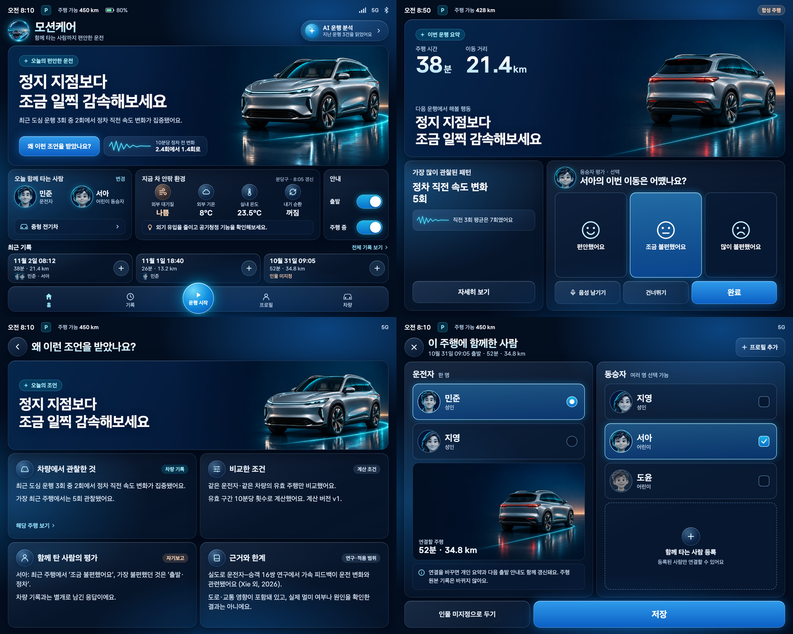

# 화면 디자인 기록

> 홈은 `Home2`, 기록 화면은 기록 담당이 고른 B 디자인([selected-b HTML](design-archive/history-b-2026-11-07/ui-review/selected-b/index.html), Android `feature/history`)이며, 2026-11-10 통합 때 공통 요소(색·배경·유리 카드·제목·버튼)를 하나로 맞췄습니다. 자세한 범위는 [앱에 구현한 홈 화면](#앱에-구현한-홈-화면)에 있고, 기록 화면의 시연 범위는 [통합 전 준비 현황](meeting-readiness/README.md)에 있습니다.

2026-11-03 기준입니다. 화면을 구현하거나 시안을 고칠 때 이 문서를 먼저 확인합니다.

## 링크

| 자료 | 위치 | 접근 조건 |
| --- | --- | --- |
| 화면 시안 (Claude Design) | [모션케어 앱 화면 시안](https://claude.ai/artifact/Rs6oUxktSkUH1nntnA7jEP) | 비공개입니다. 소유자가 공유 메뉴에서 공유해야 볼 수 있습니다. |
| 팀 보드 (Notion) | [대시보드](https://app.notion.com/p/40bae4c07fd6804ba9fed356a13e7a28), [디자인 시안 페이지](https://app.notion.com/p/40dae4c07fd68180a128ffc333949174) | 팀 워크스페이스 권한이 필요합니다. |
| Pleos 창 정책 | [Window Policy](https://document.pleos.ai/en/docs/connect/guide/docs-design/getting-started/window) | Pleos 개발자 문서 |
| Pleos 화면 모델 | [Screen model](https://document.pleos.ai/en/docs/pleos-only/vehicle-app-planning-guide/app-structure-screen-model) | Pleos 개발자 문서 |
| Pleos 글꼴 기준 | [Typography](https://document.pleos.ai/en/docs/connect/guide/docs-design/foundations/typography) | Pleos 개발자 문서 |
| Pleos 주행 방해 심사 기준 | [Driver distraction](https://document.pleos.ai/en/docs/pleos-only/distribute/app-review-guide/review-driver-distraction-elements) | Pleos 개발자 문서 |

## 현재 기준

- 시안을 열면 나오는 `2차 · 다크 글래스` 페이지가 기준입니다. `1차 시안` 페이지는 비교용으로만 남겨 두었습니다.
- 시안 작업은 위 링크에서 합니다. 저장소의 [보존 자료](#보존-자료)는 2026-11-03 시점의 사본이며, 시안을 고치면 함께 갱신합니다.
- 시안의 인물, 수치, 조언 문구, 사진은 모두 예시입니다. 실제 측정값, 의학 기준, 실제 사용자 정보가 아닙니다.

## 스타일 결정 과정

| 단계 | 방향 | 결과 |
| --- | --- | --- |
| 1차 | 현대자동차 컬러에 묵직한 느낌 | 다른 팀 시안과 비교해 스타일이 약하다고 판단해 중단 |
| 2차 | 어두운 남색 바탕, 유리 질감 카드, 생성 이미지 | 채택. 같은 스타일로 전체 화면을 제작 |

2차 방향을 잡을 때 다른 팀 시안 4개(WindowTales, 카-케스트라, 여기서 타!, 차마고치)를 비교 기준으로 삼았습니다.

## 화면 목록

크기는 시안 보드 기준이며, 실제 앱 창과의 차이는 [Pleos 제약](#시안에-아직-반영되지-않은-pleos-제약)을 확인합니다. `DrivingNarrow2`를 제외한 화면 보드는 모두 앱 하나가 앱 영역 전체를 쓰는 가로형입니다.



보드 이름을 누르면 미리보기 이미지가 열립니다.

| 보드 | 화면 | 크기 | 비고 |
| --- | --- | --- | --- |
| [KeyVisual2](design-archive/previews/KeyVisual2.png) | 키비주얼 | 1280×1280 | |
| [Home2](design-archive/previews/Home2.png) | 홈 · 출발 전 | 1600×1280 | `showApply`: 제안 공조 바로 적용 표시, 기본 꺼짐 |
| [Driving2](design-archive/previews/Driving2.png) | 주행 중 | 1600×1280 | `bannerKind`: 환경, 장시간 주행, 운전 패턴, 없음 |
| [DrivingNarrow2](design-archive/previews/DrivingNarrow2.png) | 주행 중 (1:1 창) | 840×1280 | 세로형. 실제 창 크기 미측정 |
| [Finished2](design-archive/previews/Finished2.png) | 종료 후 | 1600×1280 | |
| [TripDetail2](design-archive/previews/TripDetail2.png) | 주행 상세 | 1600×1540 | |
| [ProfileDetail2](design-archive/previews/ProfileDetail2.png) | 프로필 상세 | 1600×1280 | |
| [Reason2](design-archive/previews/Reason2.png) | 왜 이런 조언을 받았나요? | 1600×1280 | |
| [LinkPeople2](design-archive/previews/LinkPeople2.png) | 함께 탄 사람 연결 | 1600×1280 | |
| [Rating2](design-archive/previews/Rating2.png) | 동승자 평가 | 1600×1280 | |
| [History2](design-archive/previews/History2.png) | 전체 기록 | 1600×1280 | |
| [ProfileEdit2](design-archive/previews/ProfileEdit2.png) | 프로필 등록·수정 | 1600×1280 | |
| [VehicleManage2](design-archive/previews/VehicleManage2.png) | 차량 선택·관리 | 1600×1280 | |
| [FirstRun2](design-archive/previews/FirstRun2.png) | 첫 실행 | 1600×1280 | |
| [States2](design-archive/previews/States2.png) | 데이터 상태 모음 | 1600×1280 | |
| [Style2](design-archive/previews/Style2.png) | 색·글자·컴포넌트 | 1600×1280 | 스타일 기준 보드 |

## 앱에 구현한 홈 화면

2026-11-09에 `Home2`를 앱의 홈 화면으로 구현했습니다(`app`의 `home` 패키지). 색, 유리 카드, 배경, 버튼, 아이콘 경로는 이 문서의 스타일 기준과 `Home2` 소스의 값을 그대로 썼습니다. 각 칸에는 지금 구현된 기능만 연결했고, 기능이 없는 부분은 빼거나 빈 상태로 둡니다. 시안의 인물·수치·조언 예시는 넣지 않습니다. ([기록 전](pleos-emulator/shots/99_home_ready.jpg), [기록 중](pleos-emulator/shots/100_home_recording.jpg), [측정](pleos-emulator/README.md#홈-화면))

| 시안의 칸 | 앱 | 이유 |
| --- | --- | --- |
| 시각·기어·주행 가능 거리 줄 | 뺌 | Pleos 상태 표시줄을 시스템이 그림 |
| 머리말 | 앱 이름과 한 줄 소개. 오른쪽에 "자동 기록 켜짐"·"자동 기록 꺼짐" 또는 "합성 샘플 전용" | 합성 데이터는 표시해야 함. 기록이 켜져 있는지 늘 보이게 함 |
| AI 운행 분석 | 뺌 | AI 요약 미구현 |
| 오늘의 편안한 운전(큰 카드) | 기록 전에는 운전자의 출발 조언과 "왜 이런 조언을 받았나요?", 이전 기록과의 10분당 비교. 운전자가 없으면 "누가 운전하나요?"와 "좌석에서 운전자 고르기". 기록 중에는 기록 상태와 종료 버튼, 종료 후에는 기록 담당의 종료 카드 | 조언과 비교 수치는 기록 담당 `DepartureViewModel`의 계산(2026-11-10 통합) |
| 오늘 함께 타는 사람 | 좌석에 앉은 사람의 얼굴·이름·역할(운전자, 동승자, 어린이 동승자) 두 명까지. "변경"은 기록 담당의 좌석 화면 | 좌석과 얼굴은 기록 담당 화면과 같은 값 |
| 차량(중형 전기차) | 뺌 | 차량 프로필 미구현 |
| 지금 차 안팎 환경 | 외부 대기질 등급, 외부 기온, 실내 온도, 내기 순환. 값이 없으면 이유 문구 | `EnvironmentRepository.current`. 지역 이름은 `Geocoder`가 없어 빼고 갱신 시각만 표시 |
| 설정 | 운행 자동 기록 스위치와 설명, 출발 안내 스위치, 주행 중 스위치, 알림 꺼짐 안내, 안내 소리 | 차량이 없는 기기에서는 출발 안내만 보임. 자동 기록이 들어오며 제목을 "안내"에서 "설정"으로 바꾸고, 스위치 셋과 소리 선택이 스크롤 없이 보이도록 아래 줄 높이를 300에서 340으로, 소리 선택을 한 줄로 바꿈 |
| 최근 기록 | 최근 3건의 시작 시각과 길이, 함께 탄 사람(없으면 "인물 미지정"), 합성 기록은 "샘플". 누르면 운행 상세, "전체 기록 보기"는 기록 목록 | 거리는 아직 없음. 중단된 운행은 종료 시각이 다음 실행 때 정해져 길이 대신 "기록 중단" |
| 하단 탭 | 홈, 기록, 프로필(운전자 프로필, 없으면 좌석 화면), 좌석. 차량이 없는 기기는 가운데에 "샘플 시작" | 차량에서는 기어가 운행을 시작하므로 시작 버튼을 뺌([운행 자동 기록](auto-record.md)). 차량 화면이 아직 없어 그 자리에 좌석을 둠 |

- **제품 판단:** 준비 문구("주차한 상태에서 운행을 시작해 보세요"), 빈 상태 문구, 상태 표시 문구, 칸 너비와 높이는 근거가 없는 제품 판단입니다. 준비 문구의 두 번째 문장은 Pleos 측정(주행 중 화면 가림, 포그라운드 서비스 유지)에 맞춰 썼습니다.
- **크기:** 시안 보드는 1600×1280이라 앱 창 1682×1210에 맞게 큰 카드 높이를 남은 높이로 두고 나머지 높이를 줄였습니다. 글자 크기는 시안의 px를 160dpi에서 같은 sp로 옮겼고, 큰 제목은 68에서 54로, 앱 이름은 50에서 44로 줄였습니다. 위쪽 안내 띠가 생겨도 한 화면에 들어갑니다.
- **좁은 화면:** 폭 1100dp 미만이나 높이 820dp 미만에서는 카드를 세로로 쌓고 홈 전체를 스크롤합니다. 휴대폰 UI 테스트와 Pleos의 나눈 창을 위한 것이며, 나눈 창의 실제 크기는 측정하지 않았습니다.
- **글꼴:** Asta Sans를 앱에 넣지 않고 시스템 글꼴을 씁니다.
- **다른 화면과 공통 스타일:** 색, 배경, 유리 카드, 버튼 값은 `core:ui`의 `MotionStyle.kt` 한 곳에 두고 홈과 기록 담당 화면이 함께 씁니다(2026-11-10).
  - 기록 담당 화면(B 디자인)은 공통 요소만 맞췄습니다. 색 토큰(`MotionCyan`, `MotionText` 등), 배경, 유리 패널, 화면 제목·뒤로 버튼, 주·보조 버튼이 `MotionCareComponents.kt`에서 공통 값을 따릅니다.
  - 차·좌석 그림, 얼굴, 사선 제안 패널, 그래프 모양과 `MotionBlue`, 화면별 배치는 기록 담당 디자인 그대로입니다.
  - 점검 후 고친 것(2026-11-10):
    - 사선 패널·보조 패널·환경 칸에 직접 적힌 회청색 바탕을 공통 유리 바탕으로 바꿨습니다.
    - 사선 패널의 작은 제목이 기울어진 테두리 밖으로 나가던 것을 고쳤습니다. 기울기 폭을 18dp로 묶고, 왼쪽 여백을 그 두 배보다 넓게 했습니다.
    - 작은 카드 바탕(`MotionPanel`)을 유리 톤으로 바꾸고, 선택 상태는 `MotionSelected`(주 버튼 파랑 35%) 하나로 맞췄습니다.
    - 좌석의 사람 선택 창이 폭 제한을 받지 못해 화면의 90%로 펼쳐지고 바탕이 비치던 것을 420dp 불투명 카드로 고쳤습니다.
    - 좌석 화면의 스위치 이름 "안내"를 홈과 같은 "출발 안내"로 바꾸고 스위치와 간격을 뒀습니다.
    - 사선 패널은 왼쪽과 오른쪽 기울기, 네 모서리의 둥근 정도가 서로 달라 비틀린 상자로 보여, 홈과 같은 둥근 사각형 카드로 바꿨습니다(제품 판단). 기울기를 고른 평행사변형으로 되돌릴 수 있습니다.
    - 뒤로·닫기·목록 화살표·좌석 "+"·패널 화살표·응답 체크를 글자("‹" 등) 대신 `core:ui`의 `MotionIcons` 벡터로 그렸습니다. 글자는 글꼴 기준선 때문에 원 안에서 가운데에 오지 않았습니다.
    - 펼침 버튼("실제 횟수와 계산 방법" 등)을 공통 `ExpandToggle`로 바꿔 카드 글자와 같은 선에서 시작하고 아래 화살표 아이콘을 쓰게 했습니다.
    - 홈 큰 카드 안의 종료 카드가 자체 유리 패널을 한 번 더 둘러 테두리가 세 겹이던 것을 두 겹으로 줄였습니다.
    - 홈 하단 탭의 빈 오른쪽 칸에, 아직 없는 차량 화면 대신 좌석 탭을 넣어 균형을 맞췄습니다(제품 판단).
    - 출발 안내를 끄면 홈 큰 카드가 조언 대신 "출발 안내가 꺼져 있어요."를 보여 줍니다. 좌석 화면과 같은 동작입니다.
  - **글자 크기·아이콘·패턴 이름 통일(2026-11-10):** 아래 [글자 크기](#글자-크기)의 단계 하나를 모든 화면이 씁니다. 기록 화면에 11~46sp로 따로 적힌 크기 약 150곳과 고정 줄 높이를 이 단계로 옮기고, 넓은 창에서만 글꼴 배율을 1.3으로 올리던 임시 처리는 뺐습니다.
    - 카드 제목은 홈과 같은 굵기(ExtraBold)의 `SectionTitle` 하나로 그립니다. 일반 값은 홈처럼 흰 글자이고, 청록은 링크·선택·줄어든 값 같은 강조에만 씁니다. 기록 목록의 날짜가 버튼 기본색(청록)으로 보이던 것을 흰 글자로 바꿨습니다.
    - 아이콘은 `core:ui`의 `MotionIcons` 한 벌입니다. 홈의 시안 아이콘(`HomeIcons`)을 옮겨 합쳤고, 기록 화면의 글자 아이콘(⇡ ⇣ ∿ ↻ ⇄ ◷ → › ✓ ↗ ◉ ▶ ★ ✦ ＋)을 같은 선 굵기의 벡터로 바꿨습니다. 버튼은 `icon`·`leadingIcon`으로 아이콘을 붙입니다. 별점의 ★·☆와 문장 속 화살표("출발 19.1°C → 종료 …")는 글자로 둡니다.
    - 주 버튼과 보조 버튼은 `core:ui`의 `MotionPrimaryButton`·`MotionSecondaryButton` 하나입니다. 홈의 `HeroButton`, 기록 화면의 `PrimaryAction`, 운행 중 카드의 Material 기본 버튼(작은 청록 알약) 세 가지였던 것을 합쳤습니다. 목록 줄, 패턴 선택 줄, 문장 속 링크("설정 열기", "알림 켜기")는 버튼 모양을 쓰지 않습니다.
    - 패턴 이름은 [탐지 기준](detection-thresholds.md)과 같은 다섯 개로 맞췄습니다: 빠른 출발, 정차 직전 큰 감속, 반복 가감속, 빠른 회전, 반복 좌우 움직임. 같은 패턴이 화면에 따라 "출발 직후 속도 증가", "빠른 가속", "정차 전 큰 감속" 등으로 달랐습니다.
    - 좌석 화면은 차 그림 폭을 570dp로 묶던 것을 풀어 패널 높이만큼 키우고(그림 비율 1 : 1.5), 좌석 표시를 64dp에서 최대 96dp로, 오른쪽 탑승자 칸의 얼굴과 이름을 키웠습니다. 좌우 칸은 같은 폭입니다. 주변 빈 공간이 많다는 검토 의견을 따른 제품 판단입니다.
    - 에뮬레이터 23개 화면을 바꾸기 전후로 캡처해 확인했습니다. 대표 화면: [출발 전 안내](pleos-emulator/shots/109_unified_departure.jpg), [운행 상세](pleos-emulator/shots/110_unified_trip_detail.jpg), [운행 기록 중](pleos-emulator/shots/111_unified_driving.jpg).

## 스타일 기준

### 글꼴

`Asta Sans`를 쓰고 `Noto Sans KR`을 대체 글꼴로 둡니다. Asta Sans는 Pleos System UI에 적용된 글꼴이며, Pleos 문서는 실제 픽셀 높이 18px 이상을 권장합니다. 시안의 최소 크기는 20입니다.

| 용도 | 크기 | 굵기 |
| --- | --- | --- |
| 히어로 | 68 | 800 |
| 큰 제목 | 50 | 800 |
| 화면 제목 | 44 | 800 |
| 구역 제목 | 26~34 | 800 |
| 본문 | 26~28 | 500 |
| 보조 | 21~24 | 400 |
| 최소 | 20 | 400 |

위 표는 시안 보드의 값입니다. 앱은 아래 단계로 옮겨 씁니다.

### 글자 크기

`core:ui`의 `MotionType`이 모든 화면의 글자 크기 단계입니다. `MainHost`가 창 폭으로 넓은 단계와 좁은 단계를 고르고(`motionTypeFor`, 1100dp 기준), 화면은 `motionType.body`처럼 이름으로 씁니다. Material 글꼴 단계도 같은 값으로 맞춰 크기를 적지 않은 글자와 버튼·칩도 따라갑니다. 줄 높이는 글꼴에 맡겨 큰 글자가 다음 줄과 겹치지 않게 했습니다.

| 단계 | 넓은 창(차) | 좁은 창(휴대폰) | 쓰는 곳 |
| --- | --- | --- | --- |
| display | 54 | 28 | 홈 큰 카드의 조언 |
| title | 44 | 28 | 화면 제목, 앱 이름 |
| headline | 30 | 20 | 큰 숫자와 짧은 결과 |
| section | 26 | 19 | 카드·구역 제목 |
| lead | 26 | 17 | 큰 글자 아래 설명 문장 |
| body | 23 | 16 | 본문, 목록, 버튼 |
| label | 20 | 14 | 항목 이름, 칩, 보조 줄 |
| caption | 18 | 13 | 단위, 출처, 각주 |

넓은 단계는 시안의 px를 160dpi에서 같은 sp로 옮긴 값이고(큰 제목 68→54, 앱 이름 50→44, 본문 26~28→23은 창 크기에 맞춘 제품 판단), 가장 작은 글자가 Pleos 권장 18px 아래로 내려가지 않게 했습니다. 좁은 단계는 기록 화면이 휴대폰에서 쓰던 크기입니다.

### 색

| 이름 | 값 |
| --- | --- |
| 바탕 | `#030E1F` |
| Hyundai Blue | `#002C5F` |
| 주 버튼 | `#2F9BEA`에서 `#0B5FC4`로 이어지는 세로 그라데이션 |
| Active Blue | `#00AAD2` |
| 빛나는 강조 | `#5FE0FB` |
| Light Sand | `#E4DCD3` |
| 주의 | `#FFD3B3` |
| 본문 글자 | `#EAF4FF` |

### 공통 표면

```css
/* Screen background */
background:
  radial-gradient(1100px 620px at 82% 4%, #0B447F 0%, rgba(11, 68, 127, 0) 62%),
  radial-gradient(900px 620px at 4% 58%, #07365F 0%, rgba(7, 54, 95, 0) 60%),
  radial-gradient(1000px 480px at 60% 104%, #06396B 0%, rgba(6, 57, 107, 0) 62%),
  #030E1F;

/* Glass card */
border-radius: 28px;
background: linear-gradient(155deg, rgba(122, 176, 240, 0.16) 0%, rgba(40, 84, 140, 0.10) 55%, rgba(12, 34, 66, 0.30) 100%);
border: 1.5px solid rgba(156, 205, 255, 0.26);
box-shadow: 0 18px 44px rgba(0, 6, 20, 0.5), inset 0 1.5px 0 rgba(255, 255, 255, 0.18);

/* Primary button */
background: linear-gradient(180deg, #2F9BEA 0%, #0B5FC4 100%);
border: 1.5px solid rgba(170, 225, 255, 0.65);
```

### 이미지

Codex CLI로 생성한 이미지입니다. 시안 안에서는 `/_blob/<ID>`로 참조합니다. [design-archive/images](design-archive/images)에는 아래 화면용 파일과 함께 고해상도 PNG 원본, 생성 프롬프트가 있습니다.

| 용도 | 파일 | 자산 ID |
| --- | --- | --- |
| 키비주얼 | `kv.jpg` | `88501f2ab61932bf369412a577418f98` |
| 차량 | `car.jpg` | `764444c7f24c23434c770b43c49a2f0a` |
| 차량 (작은 크기) | `car_small.jpg` | `82662963fa94eafbc3ee1baa566220df` |
| 앱 아이콘 | `appicon.png` | `ae0818b1521fa4b61f165d9cc72fea0d` |
| 도로 | `road.jpg` | `2059ab7c736404042a8ca812601e8704` |
| 도착 | `arrive.jpg` | `53b555997199fb0c449876c15ae67d0a` |
| 예시 프로필 서아 | `avatar_child_s.jpg` | `4cec43282a9fc4fce1e5dae98de2900b` |
| 예시 프로필 민준 | `avatar_adult_s.jpg` | `d037b8f6d888fe055acc1463e9f4069d` |
| 예시 프로필 지영 | `avatar_woman_s.jpg` | `b9b9803b95f883f521b56d7ead990c8f` |
| 예시 프로필 도윤 | `avatar_boy_t.jpg` | `fb413833e6479ba6e3b7d29344a17f81` |

#### 고를 수 있는 캐릭터

사람을 추가하거나 프로필을 고칠 때 고르는 캐릭터 24개입니다(`feature/history/src/main/res/drawable-nodpi/mc_character_01~24.png`, 256×256). 추가 창은 무작위 캐릭터로 시작하고, "다른 캐릭터"는 지금과 다른 캐릭터를 무작위로 고릅니다. 고른 캐릭터는 사람마다 `PersonProfile.avatar`(`character_01` 등)로 저장되고, 고르지 않은 사람은 지금처럼 성인·어린이 얼굴이 보입니다.

- **출처와 라이선스:** [DiceBear](https://www.dicebear.com/) 9.4.3의 "Adventurer" 스타일(그림 Lisa Wischofsky, [CC BY 4.0](https://creativecommons.org/licenses/by/4.0/))로 그려 PNG로 넣었습니다. CC BY는 저작자 표시가 필요해 캐릭터를 고르는 화면 아래에 "캐릭터 그림: Adventurer, Lisa Wischofsky (CC BY 4.0)"를 적었습니다. 그림 자체는 고치지 않았습니다. 저작자 표시가 필요 없는 CC0 스타일(Lorelei, Open Peeps 등)도 비교했지만, 아이 동승자에게 어울리는 표정과 색은 Adventurer가 낫다고 판단했습니다(제품 판단).
- **고른 기준:** 무작위로 두면 화난 얼굴, 혀 내민 얼굴, 선글라스가 섞여 입 9종·눈 18종·눈썹 10종으로 제한하고, 투명 안경만 남겼습니다. 후보 40명 가운데 피부색, 머리색, 나이대가 고르게 섞이게 24명을 골랐습니다(제품 판단).
- **바꾸지 말 것:** 키(`character_01`~`24`)는 저장된 값이라 순서와 이름을 바꾸지 않습니다. 새 캐릭터는 뒤에 추가합니다.
- **화면:** [사람 추가 창](pleos-emulator/shots/112_add_person_character.jpg)

## 시안에 아직 반영되지 않은 Pleos 제약

2026-11-03에 Pleos Connect 에뮬레이터 v2.1.0(API 34)에서 시험 앱으로 측정한 결과입니다. 실차와 App Market 심사에서는 확인하지 못했고, 권한은 adb로 강제로 부여했습니다. 측정 방법과 캡처는 [측정 기록](pleos-emulator/README.md)에 있습니다.

### 창 크기

- 전체 화면은 2560×1440, 160dpi입니다.
- 앱 하나가 앱 영역 전체를 쓰는 가로형 창은 **1682×1210**이고 시작 위치는 x=853, y=90입니다. 시안의 1600×1280은 이 크기에 맞게 고쳐야 합니다.
- 왼쪽 시스템 주행 영역(약 853px), 앱 위 상태 표시줄(90px), 하단 바(140px)는 시스템이 그립니다. 앱이 주행 영역을 가리거나 닫을 수 없습니다.
- 시험에서는 앱을 열면 같은 창의 내비를 대신했습니다.
- Pleos 문서 기준으로 앱은 최대 2개까지 함께 표시됩니다. 두 앱의 배치는 Connect-S가 1:1, Connect-W가 2:1 또는 1:2입니다. 이렇게 나뉜 창의 실제 크기와 동작은 시험하지 않았습니다.
- Pleos 기획 가이드는 세로형과 가로형을 모두 설계하라고 안내합니다. 세로형에는 핵심 기능과 정보를, 가로형에는 추가 정보와 확장 기능을 넣는 방식입니다. 현재 시안의 세로형 보드는 `DrivingNarrow2`뿐입니다.

### 내비 표시 중 알림

40km/h 주행 중 내비를 띄우고 중요도 높음으로 시험했습니다.

| 방식 | 내비 위 표시 | 비고 |
| --- | --- | --- |
| 일반 알림, 리마인더, 상태 | 안 뜸 | 종 배지도 표시되지 않음. 일반 알림은 알림 센터를 직접 열어야 보임 |
| 메시지, 내비 카테고리 | 뜸 | 앱 영역 상단에 작은 카드로 표시됨 |
| 전화 카테고리 | 불명확 | 카드는 없고 운전 영역에 수락/거절 화면이 나타남. 우리 알림 때문인지 확정하지 못함 |
| 토스트 | 안 보임 | 주차 중에도 안 보임 |
| 오버레이 | 일반 사용자는 불가 | adb로 권한을 강제로 줄 때만 표시되고, 사용자가 허용할 설정 화면이 없음 |

**주행 중 안내 방식:** 2차 회의 방향대로 내비 위 상단 카드로 보여 줍니다. `CATEGORY_MESSAGE` 알림으로 보내면 메시지 알림처럼 잠깐 떴다 사라집니다. ([시험 문구 화면](pleos-emulator/shots/70_msg_real_copy.png), [앱의 카드](pleos-emulator/shots/85_guidance_card.png))

- **표시:** 앱 창 왼쪽 위에 약 9초 보입니다. 문구는 두 줄(줄당 약 30자)을 넘으면 잘리므로 짧게 씁니다.
- **연속 안내:** 쌓이지 않고 마지막 안내만 보이므로 앱에서 간격을 조절합니다. 규칙과 문구는 [안내 카드의 근거](guidance-card.md)에 있습니다.
- **끄기:** 홈 화면 "안내" 카드의 "주행 중 안내" 스위치로 끕니다. 차량 입력이 있을 때만 보입니다. ([스위치 화면](pleos-emulator/shots/86_guidance_switch.png))
- **알림이 꺼져 있을 때:** 스위치 아래에 카드가 뜨지 않는다고 알리고 "알림 켜기"를 둡니다. Pleos 설정에는 앱 단위 알림 스위치만 있습니다. ([안내 화면](pleos-emulator/shots/93_notification_notice.png), [규칙](guidance-card.md#알림이-꺼져-있을-때))
- **소리:** 카드가 뜰 때 알림음이나 음성으로 한 번 알립니다. 기본은 알림음이고 스위치 아래 "안내 소리"에서 고릅니다. 알림이 꺼져 있으면 소리도 나지 않아 이 선택을 숨깁니다. 통화·내비 음성과 겹치면 소리만 생략합니다. ([선택 화면](pleos-emulator/shots/89_guidance_sound_choice.png), [규칙](guidance-card.md#소리))
- **문구:** 탐지한 패턴에 맞는 행동 하나를 "~해보세요"로 권합니다. 핵심 조언은 출발 전과 종료 후 화면에도 넣습니다.
- **탭 동작:** 넣지 않습니다. 앱 화면은 주행 중에도 보이지만, 카드를 눌러 앱으로 가면 내비가 가려지기 때문입니다(제품 판단).
- **심사 위험:** 이 방식을 직접 금지한 문구는 찾지 못했지만, Pleos 용어집은 이 알림을 통화·메시지·내비처럼 즉시 인지가 필요한 알림으로 정의합니다. App Market 심사 통과 여부를 알 수 없어 운영사무국에 문의합니다.
- **막힐 때 대안:** 우리 앱이 보일 때는 앱 안 배너, 내비가 보일 때는 알림 센터로 보냅니다. 전환하기 쉽도록 안내 판단과 표시 코드를 분리합니다.

내비 앱 화면 안에 직접 문구를 넣는 API는 Pleos 문서에서 찾지 못했습니다. 경로 안내 화면을 가리는지와 실차 스피커의 음량·음질은 확인하지 못했습니다.

### 속도 권한을 거부했을 때

- **홈 화면 위쪽 안내 띠:** 요청 창에서 거부하면 "차량 속도 권한이 있어야 운행을 기록할 수 있습니다."만 보입니다. 요청 창이 더 뜨지 않으면 그 아래에 "설정 > 권한 > 위치에서 허용하면 기록할 수 있어요"와 "설정 열기"를 둡니다. ([안내 화면](pleos-emulator/shots/102_home_speed_notice.jpg))
- **설정:** Pleos 차량 설정의 앱 화면에는 알림 스위치만 있어 속도 권한을 켤 수 없습니다. "설정 열기"는 Car Settings의 앱 정보를 엽니다. 속도 권한은 위치 권한 그룹이라 설정에서도 "위치"로 보입니다. ([측정](pleos-emulator/README.md#속도-권한-거부))

### 주행 중 화면 표시

- 일반 화면은 5km/h와 40km/h 모두에서 시스템 화면 "주행 중에는 사용할 수 없습니다"로 가려졌습니다. 주차하면 자동으로 돌아옵니다.
- Activity에 `distractionOptimized`를 선언하면 40km/h에서도 보입니다. 단, 같은 task 아래에 선언하지 않은 화면이 있으면 가려집니다.
- 현재 앱은 `MainActivity` 하나로 구성되어 있어, 2026-11-09에 여기에 선언했습니다. 시험과 시연에서 주행 중에도 홈 화면이 보입니다. 공모전은 출시 가능한 완제품을 조건으로 하지 않고 App Market 입점 심사는 별도라서 내린 주행 담당 결정입니다. ([40km/h 화면](pleos-emulator/shots/103_driving_app_visible.jpg), [측정](pleos-emulator/README.md#주행-중-앱-화면))
- 선언한 앱은 주행 제한을 직접 따라야 합니다. 시험에서 N·D 기어 제한값은 80(설정 화면과 영상 금지)이었습니다. 홈에는 영상과 입력 양식이 없지만, 설정 카드의 스위치와 소리 선택은 주행 중에도 바뀝니다. App Market에 올리기 전에 처리합니다.

### 기록과 화면의 관계

- 일반 서비스는 앱이 뒤로 가고 60초 뒤 종료되었습니다. 포그라운드 서비스는 내비 뒤에서 171초 동안 끊기지 않았습니다.
- 2026-11-10부터 자동차 기기에서는 "운행 자동 기록"을 켜 두면 포그라운드 서비스가 주행 사이에도 남아 기어를 보고, P에서 출발하면 기록을 시작합니다. 켜기는 홈 화면의 스위치에서 하고, 부팅·앱 업데이트 뒤에는 방송 수신기가 다시 켭니다. 규칙과 측정은 [운행 자동 기록](auto-record.md)에 있습니다.

## 보존 자료

| 위치 | 내용 |
| --- | --- |
| [design-archive/source](design-archive/source) | 1차·2차 보드 소스 31개와 `canvas.json`. 파일 크기가 게시본과 일치함을 확인 |
| [design-archive/previews](design-archive/previews) | 2차 보드 16개 PNG와 주요 화면 모음 `sheet.png` |
| [design-archive/images](design-archive/images) | 화면용 이미지, PNG 원본, 생성 프롬프트 |
| [design-archive/tools](design-archive/tools) | 미리보기 생성 도구 `render.py` |
| [pleos-emulator](pleos-emulator/README.md) | 에뮬레이터 측정 결과, 캡처, 로그, 시험 앱 소스 |

미리보기는 간이 실행기와 Chrome으로 만든 정지 화면이라 실제 캔버스와 다를 수 있습니다. 조정값은 기본값으로 렌더링합니다. 다시 만들려면 Chrome을 설치하고 아래처럼 실행합니다.

```sh
python3 docs/design-archive/tools/render.py Home2 1600 1280
```

## 남은 일

- [ ] 가로형 보드 크기를 1682×1210 기준으로 고치기
- [ ] 세로형 창의 실제 크기를 재고 `DrivingNarrow2`를 고치기
- [ ] 나머지 화면의 세로형 배치 정하기
- [ ] 내비 위 상단 카드를 시안에 반영하기. 현재 `Driving2`의 배너는 앱 안 표시입니다.
- [ ] App Market에 올리기 전에 주행 중 제한(설정 화면 금지)을 앱에서 따르기
- [ ] 운영사무국에 `distractionOptimized` 선언과 `android.car.permission.CAR_SPEED` 권한의 승인 여부 문의하기
- [ ] 알림음과 음성을 실제로 들어 보고 음색 정하기
- [ ] 공조 제어 호출, 자동 시작 확인하기
- [x] 기록 담당 B 화면(PR #20)을 합쳐 홈 큰 카드에 출발 조언, 사람 카드에 좌석·운전자, 안내 카드에 출발 안내, 하단 탭에 기록을 연결하기 (2026-11-10)
- [ ] 홈 화면을 세로형 창에서 확인하기
